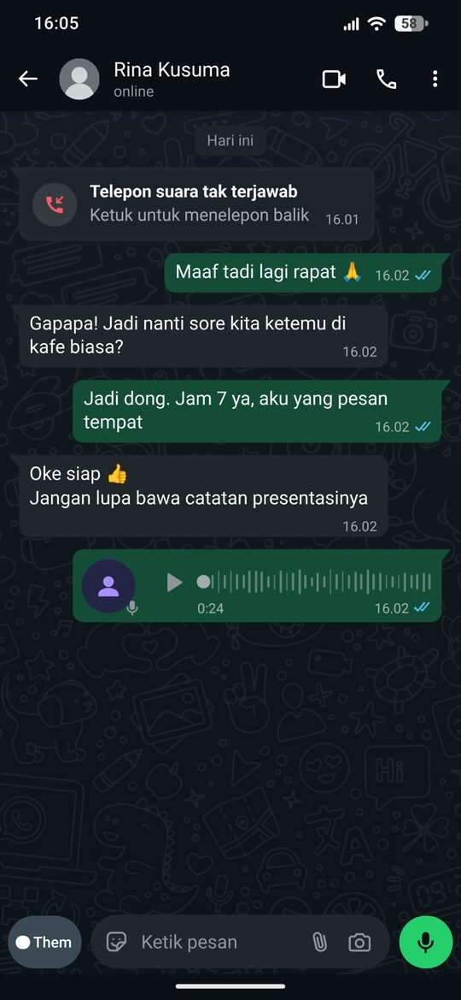
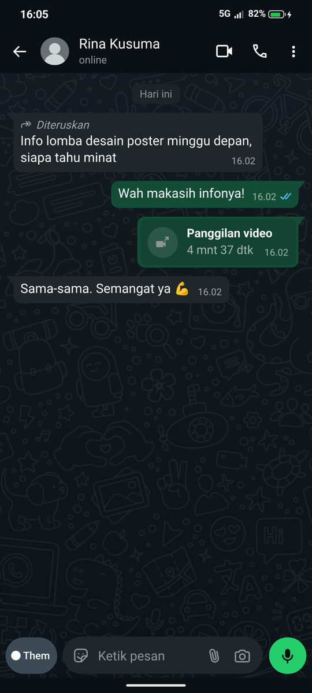
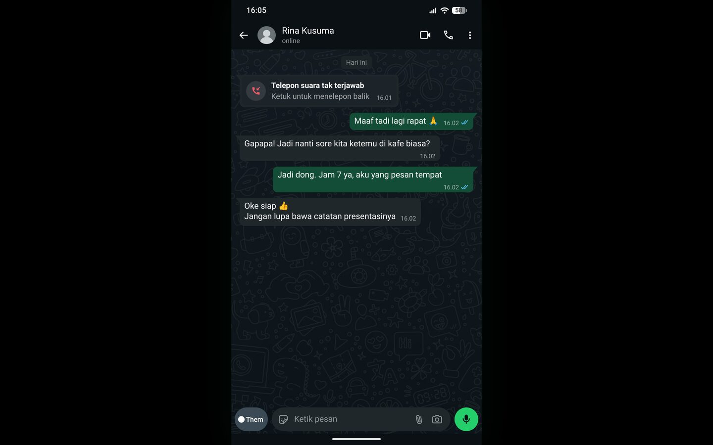

<div align="center">

# Fake Chat

**Generator mockup percakapan bergaya aplikasi chat untuk cerita fiksi, desain, dan pembelajaran.**
Susun percakapan dua arah, atur status bar ponsel, lalu simpan sebagai gambar PNG atau video.
Semua proses berjalan di browser, tanpa akun dan tanpa server.

[](https://andikapramudya-project.github.io/Fake-Chat/)
[](https://github.com/andikapramudya-project/Fake-Chat/actions/workflows/check.yml)
[](https://github.com/andikapramudya-project/Fake-Chat/actions/workflows/deploy.yml)


[**Buka demo**](https://andikapramudya-project.github.io/Fake-Chat/) ·
[Laporkan masalah](https://github.com/andikapramudya-project/Fake-Chat/issues) ·
[Catatan asal-usul](NOTICE.md)

</div>

## Daftar isi

- [Tampilan](#tampilan)
- [Fitur](#fitur)
- [Mulai cepat](#mulai-cepat)
- [Cara penggunaan](#cara-penggunaan)
- [Pengembangan](#pengembangan)
- [Deploy ke GitHub Pages](#deploy-ke-github-pages)
- [Struktur proyek](#struktur-proyek)
- [Teknologi](#teknologi)
- [Batasan dan privasi](#batasan-dan-privasi)
- [Pengelola dan kontribusi](#pengelola-dan-kontribusi)

## Tampilan

Semua contoh di bawah memakai nama dan percakapan fiktif.

<table>
  <tr>
    <th>Ponsel · gaya Pixel 8 Pro</th>
    <th>Ponsel · gaya Poco X7 5G</th>
  </tr>
  <tr>
    <td align="center"></td>
    <td align="center"></td>
  </tr>
  <tr>
    <td>Panggilan tak terjawab, pesan multiline, dan pesan suara 0:24.</td>
    <td>Baterai mengisi 82%, sinyal 5G, label <i>Diteruskan</i>, dan panggilan video.</td>
  </tr>
</table>

**Desktop.** Di layar lebar, aplikasi menampilkan bingkai ponsel 9:16 di tengah layar,
sehingga hasil ekspor tetap berproporsi ponsel.

<p align="center">
  
</p>

## Fitur

**Percakapan**
- Percakapan dua arah dengan pemilih pengirim **You / Them**.
- Pesan teks multiline, foto dengan caption (pilih file, paste, atau drag-and-drop).
- Simulasi rekaman dan pesan suara You/Them, tanpa mikrofon dan tanpa audio asli.
- Kartu riwayat panggilan suara dan video: masuk/keluar, terjawab, tidak terjawab, dibatalkan.
- Label **Diteruskan** pada teks, foto, dan pesan suara, plus tombol terusan di samping foto.
- Pemisah tanggal ("Hari ini", "Kemarin", nama hari, atau tanggal lengkap) yang bisa ditambah di tengah chat.
- Tekan-tahan atau klik kanan pesan untuk mengubah jamnya. Urutan waktu tetap dijaga.

**Kontak dan header**
- Nama, status, dan foto profil dapat diubah; status bisa disembunyikan.
- Avatar abu-abu bawaan, warna polos, atau foto dari perangkat.
- Mode header **telepon saja (▾)** seperti chat bisnis.

**Status bar ponsel**
- Dua gaya: **Pixel 8 Pro** dan **Poco X7 5G**.
- Jam 24 jam yang bisa diatur, tidak berjalan sendiri.
- Baterai 0–100% dengan mode **Normal**, **Charging**, atau **Low**.
- Jaringan **Wi-Fi**, **LTE**, atau **5G** dengan 1–4 batang sinyal.

**Bahasa Indonesia seperti aslinya**
- "Hari ini", "Ketik pesan", jam "16.01", "Telepon suara", "13 dtk", "Ketuk untuk menelepon balik".

**Ekspor**
- Screenshot PNG dari tampilan chat yang terlihat.
- Video 30 fps lewat WebCodecs, lengkap dengan suara pesan dan tombol batal.
- Replay percakapan setiap dua detik.
- Kontrol editor tidak ikut terekspor.

## Mulai cepat

Cara termudah: buka **[demo live](https://andikapramudya-project.github.io/Fake-Chat/)**.
Tidak perlu instalasi.

Untuk menjalankan di komputer sendiri, gunakan Node.js **22.12 atau lebih baru**:

```sh
git clone https://github.com/andikapramudya-project/Fake-Chat.git
cd Fake-Chat
npm ci
npm run dev
```

Buka alamat yang ditampilkan Vite, biasanya `http://localhost:3000`.

## Cara penggunaan

| Kebutuhan | Langkah |
| --- | --- |
| Mengirim teks | Ketik lalu tekan **Enter** atau tombol kirim. **Shift + Enter** untuk baris baru. |
| Mengganti pengirim | Klik pemilih **You / Them** sebelum mengirim. |
| Mengubah kontak | Klik nama atau status di header. Klik foto untuk memilih warna avatar atau mengunggah foto. |
| Menyembunyikan status kontak | Menu **⋮ → Show contact status**. |
| Mengubah jam status bar | Klik jam, isi jam (00–23) dan menit (00–59), lalu **Save clock**. |
| Mengubah baterai | Klik ikon baterai, isi 0–100, pilih **Normal**, **Charging**, atau **Low (red)**, lalu **Save battery**. |
| Mengubah jaringan | Klik ikon sinyal, pilih **Wi-Fi**, **LTE**, atau **5G** dan jumlah batang, lalu **Save network**. |
| Memilih gaya ponsel | Menu **⋮ → Pixel 8 Pro** atau **Poco X7 5G**. |
| Header telepon saja | Menu **⋮ → Phone icon only (▾)**. Ikon telepon menambah telepon suara, ▾ menambah panggilan video. |
| Menambah panggilan | Klik ikon telepon atau video di header, isi arah, hasil, durasi, dan waktu, lalu **Add call**. Klik kartu untuk mengedit atau menghapus. |
| Pesan suara | Dengan kotak pesan kosong, klik mikrofon hijau, atur pengirim dan durasi, lalu **Start simulation**. |
| Mengirim foto | Klik lampiran/kamera, paste foto, atau seret file ke chat. Teks di input menjadi caption. |
| Mengubah jam pesan | Tekan-tahan (atau klik kanan) pesan. Jam dibatasi antara pesan sebelum dan sesudahnya. |
| Pesan terusan | Tekan-tahan pesan, centang **Forwarded (Diteruskan)**. Untuk foto, bisa ditambah **Forward button beside the photo**. |
| Mengubah tanggal | Klik label tanggal ("Hari ini") di atas chat. |
| Menambah pemisah tanggal | Menu **⋮ → Add date divider**, atau **Add date above** di dialog jam pesan. |
| Memindahkan pesan | Klik dua kali pada gelembung pesan. |
| Menyimpan gambar | Menu **⋮ → Take screenshot**. |
| Menyimpan video | Menu **⋮ → Save video**. Biarkan tab terbuka hingga selesai. |
| Memutar ulang | Menu **⋮ → Replay chat**. |
| Menghapus semua pesan | Menu **⋮ → Clear chat**, lalu konfirmasi. |
| Membuka panduan | Menu **⋮ → How to use**. |

<details>
<summary>Catatan replay, video, dan gaya status bar</summary>

- Screenshot menyimpan area yang terlihat, bukan seluruh riwayat chat panjang.
- Pada replay dan video, pesan suara didahului adegan rekaman sepanjang
  **Recording scene** (bawaan 3 detik), terlepas dari durasi pesan suaranya.
- Kartu panggilan tidak memutar suara notifikasi.
- **Pixel 8 Pro** mengikuti resolusi 1008×2244 (mode FHD+): baterai pil dengan angka di dalam.
- **Poco X7 5G** memakai asumsi gaya HyperOS: jam tebal, sinyal tipis, baterai garis luar
  dengan persentase di samping.
- Font asli perangkat (Google Sans, MiSans) tidak disertakan; keduanya memakai Roboto.
- Lubang kamera tidak digambar.

</details>

## Pengembangan

| Perintah | Fungsi |
| --- | --- |
| `npm start` / `npm run dev` | Menjalankan server pengembangan |
| `npm test` | Menguji model data (jam, baterai, panggilan, pesan suara, timeline) dan pembatalan replay |
| `npm run test:browser` | Menguji alur aplikasi di Chromium dengan Playwright |
| `npm run build` | Membuat aplikasi produksi di `build/` |
| `npm run preview` | Membuka hasil build secara lokal |
| `npm audit` | Memeriksa kerentanan dependensi |

Sebelum `npm run test:browser` pertama kali, jalankan sekali
`npx playwright install --no-shell chromium`. Gunakan data fiktif di setiap tes.

## Deploy ke GitHub Pages

Repository ini sudah punya dua workflow:

- **Check project** (`check.yml`) berjalan di setiap pull request dan push ke `main`:
  tes model, build, dan tes browser.
- **Deploy to GitHub Pages** (`deploy.yml`) berjalan di setiap push ke `main`:
  tes, build, lalu menerbitkan folder `build/`.

Langkah awal:

1. Di **Settings → Pages → Build and deployment**, pilih **GitHub Actions**.
2. Push ke `main`, atau jalankan **Actions → Deploy to GitHub Pages → Run workflow**.
3. Situs tersedia di <https://andikapramudya-project.github.io/Fake-Chat/>.

`base: "./"` di `vite.config.js` membuat build bisa dihosting di subfolder mana pun.
Untuk hosting lain, cukup unggah isi `build/`.

## Struktur proyek

```text
.github/workflows/   Pemeriksaan dan deployment GitHub Pages
docs/preview/        Gambar preview untuk README (data fiktif)
public/              Manifest dan aset statis
src/
  App.jsx            State, layout, dan penguncian editor
  config.js          Identitas pengelola dan repository
  model.js           Model pesan, pengaturan ponsel, label panggilan, dan timeline
  utils.js           Pengolahan gambar dan screenshot
  timing.js          Waktu tunggu yang dapat dibatalkan
  video.js           Renderer video WebCodecs melalui Mediabunny
  sounds.js          Audio pesan dan timeline video
  components/        Status bar, header, chat, dialog, menu, panduan, dan progres
tests/
  *.test.js          Tes unit dengan node:test
  browser/           Tes end-to-end dengan Playwright
NOTICE.md            Asal-usul kode dan status hak pihak ketiga
```

## Teknologi

| Bagian | Pustaka |
| --- | --- |
| Antarmuka | [React 19](https://react.dev/) |
| Build dan dev server | [Vite 6](https://vite.dev/) |
| Screenshot | [html-to-image](https://github.com/bubkoo/html-to-image) |
| Video | [Mediabunny](https://mediabunny.dev/) di atas WebCodecs |
| Font | [Roboto](https://fontsource.org/fonts/roboto) via Fontsource |
| Tes | `node:test` dan [Playwright](https://playwright.dev/) |

## Batasan dan privasi

- Percakapan dan profil hanya disimpan di memori tab. **Refresh atau menutup tab akan menghapusnya**,
  jadi ekspor hasil sebelum meninggalkan halaman. Hanya status panduan yang disimpan di localStorage.
- Tidak ada akun, database, analitik, atau pengiriman pesan ke layanan chat mana pun.
  Penyedia hosting tetap dapat mencatat permintaan halaman seperti situs biasa.
- Gambar dikecilkan hingga sisi terpanjang 1280 piksel; batas per file 15 MB.
- Video memerlukan WebCodecs di browser terbaru melalui HTTPS atau localhost.
  Format utama MP4/H.264, dengan cadangan WebM. Video panjang dan banyak foto bisa memakai banyak RAM.

> [!IMPORTANT]
> Gunakan hanya untuk cerita fiksi, mockup desain, atau pembelajaran, dan beri konteks bahwa
> hasilnya simulasi. Jangan gunakan untuk penipuan, menyamar sebagai orang lain, atau membuat
> bukti palsu. Proyek ini tidak berafiliasi dengan WhatsApp atau Meta.

## Pengelola dan kontribusi

**Andika Pramudya** · [@andikapramudya-project](https://github.com/andikapramudya-project)

Saat melaporkan masalah, sertakan browser, perangkat, langkah reproduksi, dan contoh
percakapan fiktif tanpa data pribadi. Identitas proyek berada di `src/config.js`,
`package.json`, `index.html`, dan `public/manifest.json`.

Belum ada lisensi distribusi umum untuk keseluruhan proyek. Kode awal berasal dari proyek
lain; catatan asal-usul, dependensi, dan aset ada di [NOTICE.md](NOTICE.md).
